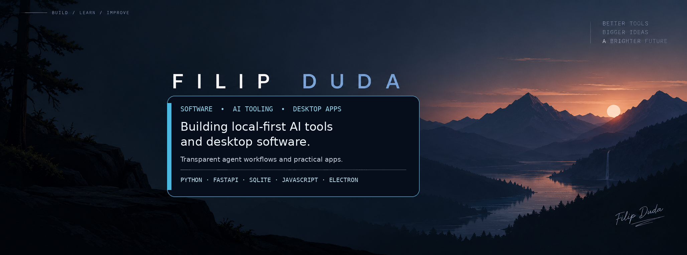

  

# 👋 Hi, I'm Filip

### Developer • AI tooling • local-first software

I build local-first tools with inspectable agent workflows and practical desktop apps.

## 🧠 What I'm building

- 🚀 **[Helm](https://github.com/menamefilip/helm)** — a local-first workspace for supervised AI-agent work.
- 🎧 **[Music Buddy](https://github.com/menamefilip/music-player)** — an Electron desktop audio-file visualizer.

## 🚀 Featured project

### [Helm — supervised AI-agent workspace](https://github.com/menamefilip/helm)

Helm brings projects, chats, staged runs, and reviewable artifacts into one local-first workspace.

- **Clear execution flow:** Input → Plan → Execute → Review → Final output
- **Inspectable runs:** tool activity, artifacts, terminal output, and diffs
- **Focused context:** deterministic XS/S/M/L tiers
- **Local by default:** SQLite and user-selected workspace; optional agent runtime

**Built with:** Python · FastAPI · SQLite · JavaScript · pytest · GitHub Actions

## 🎧 Other project

### [Music Buddy](https://github.com/menamefilip/music-player)

A small Electron desktop widget that plays selected local audio files and visualizes their frequency spectrum.

**Built with:** JavaScript · Electron · Web Audio API

## 🛠️ Tech

Python · FastAPI · SQLite · JavaScript · Electron · Git

## 📫 Contact

Open to interesting projects, collaboration, and opportunities — reach me through GitHub.

[Browse my repositories](https://github.com/menamefilip?tab=repositories)
